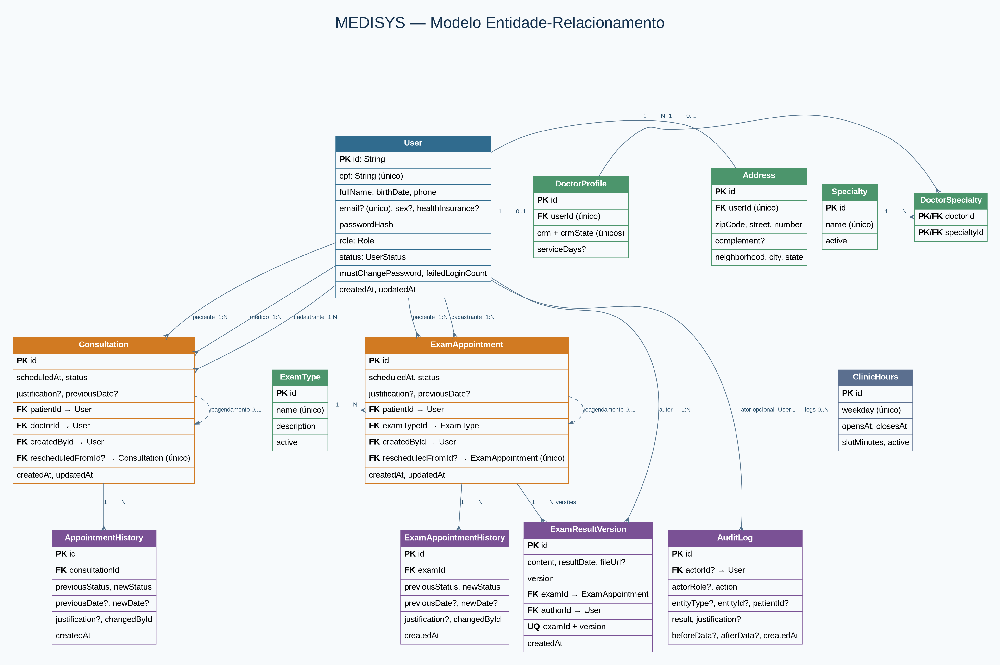

# Modelagem do banco de dados

O Medisys utiliza PostgreSQL no Supabase, acessado pela aplicação por meio do Prisma ORM.

A modelagem abaixo representa as tabelas, campos principais, chaves, restrições e relacionamentos existentes no banco de dados do projeto.

## Observações

- `User` centraliza os dados comuns de pacientes, médicos, atendentes e administradores;
- `DoctorProfile` armazena os dados específicos dos médicos;
- `DoctorSpecialty` representa o relacionamento entre médicos e especialidades;
- `Consultation` e `ExamAppointment` armazenam os agendamentos;
- `AppointmentHistory` e `ExamAppointmentHistory` preservam as alterações dos agendamentos;
- `ExamResultVersion` mantém as diferentes versões dos resultados de exames;
- `AuditLog` registra as operações importantes realizadas no sistema;
- A tabela interna `_prisma_migrations` não aparece no diagrama por ser utilizada apenas pelo Prisma para controlar migrações.

O diagrama foi validado com o arquivo `prisma/schema.prisma` e com as tabelas existentes no Supabase.
