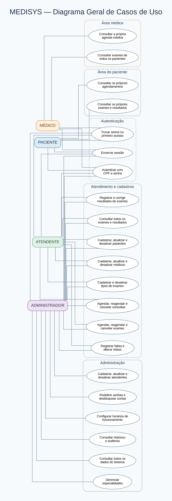

# Casos de uso

O diagrama geral apresenta as principais ações disponíveis para cada perfil do Medisys no escopo do MVP.

## Perfis representados

- **Paciente:** acessa os próprios agendamentos, exames e resultados;
- **Atendente:** realiza cadastros, administra consultas e exames e registra resultados;
- **Médico:** consulta a própria agenda e os exames de todos os pacientes;
- **Administrador:** possui as operações administrativas e também pode executar as operações dos demais perfis.

Todos os perfis utilizam CPF e senha para autenticação, devem trocar a senha no primeiro acesso e podem encerrar a sessão.

O diagrama foi elaborado com base nos requisitos funcionais, nas regras de negócio e na matriz de permissões documentada no projeto.
