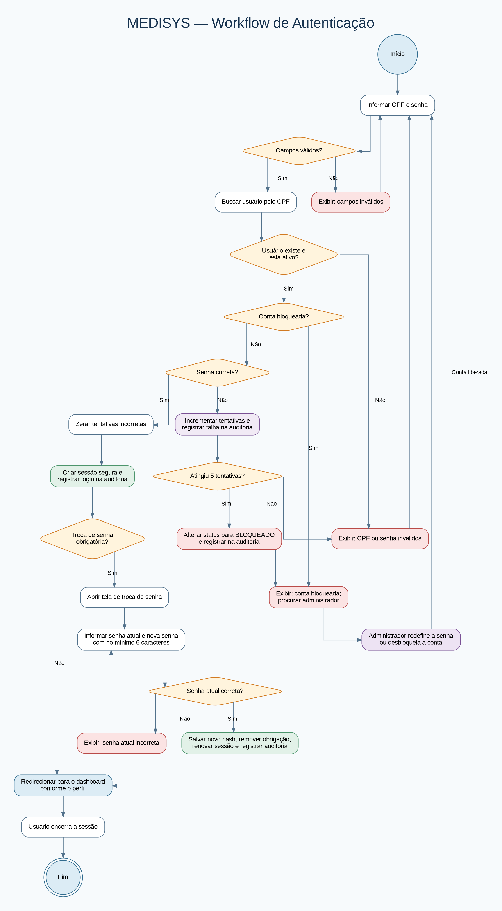

# Workflow de autenticação

O fluxo de autenticação utiliza CPF e senha e é comum aos quatro perfis do Medisys.

## Regras representadas

- Validação dos campos informados;
- Verificação do usuário e da situação da conta;
- Bloqueio após cinco tentativas incorretas;
- Registro dos eventos de autenticação na auditoria;
- Desbloqueio ou redefinição de senha somente pelo administrador;
- Troca obrigatória da senha no primeiro acesso;
- Senha com no mínimo seis caracteres;
- Criação e renovação da sessão após autenticação ou troca de senha;
- Redirecionamento para o dashboard conforme o perfil;
- Encerramento da sessão pelo usuário.

O fluxo foi validado com os requisitos funcionais e com as rotas de login e troca de senha implementadas no sistema.
