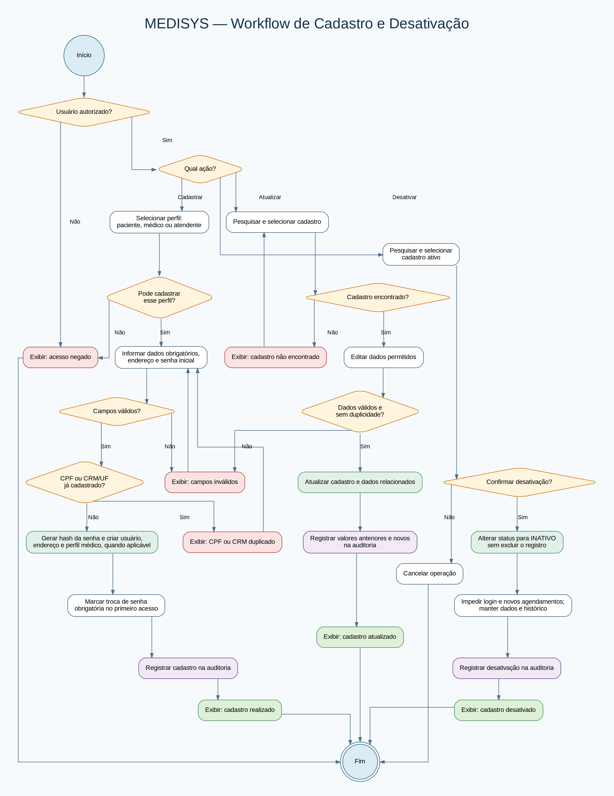

# Workflow de cadastro e desativação

O fluxo apresenta as operações de cadastro, atualização e desativação de pacientes, médicos e atendentes.

## Regras representadas

- Verificação da permissão do usuário autenticado;
- Atendentes podem gerenciar pacientes e médicos;
- Somente administradores podem gerenciar atendentes;
- Validação dos campos obrigatórios;
- Validação de CPF e da combinação CRM/UF sem duplicidade;
- Armazenamento da senha utilizando hash;
- Troca obrigatória da senha inicial;
- Atualização dos dados cadastrais e relacionados;
- Desativação lógica pelo status `INATIVO`, sem exclusão definitiva;
- Preservação dos dados e históricos anteriores;
- Registro de cadastros, alterações e desativações na auditoria;
- Apresentação de mensagens claras de sucesso ou erro.

O fluxo foi validado com os requisitos funcionais e com as rotas de usuários implementadas no sistema.
