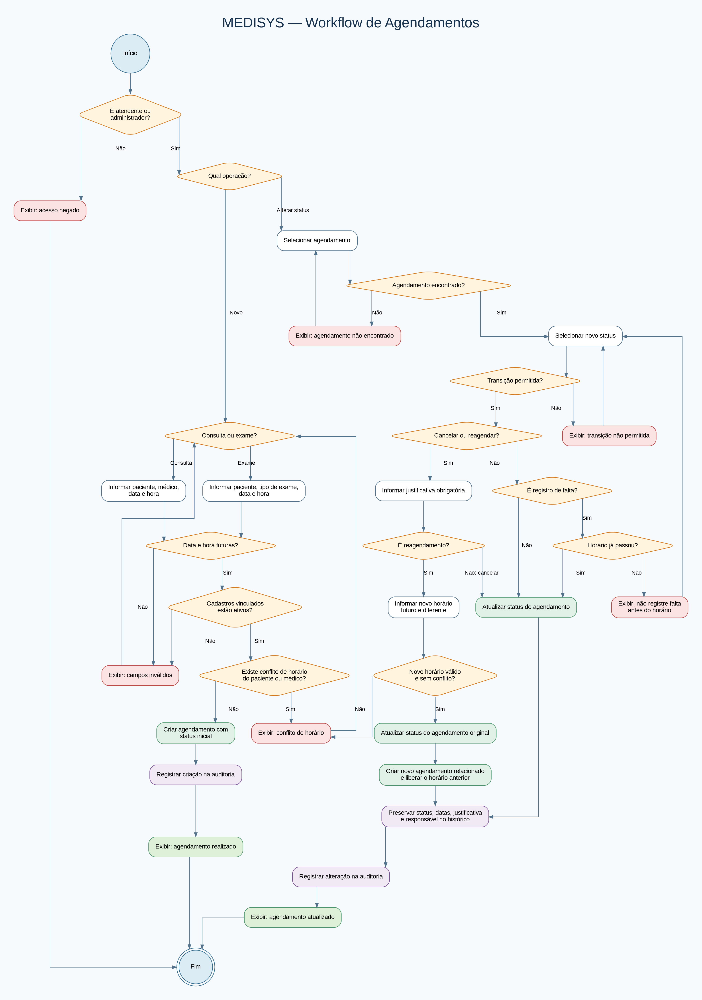

# Workflow de agendamentos

O fluxo apresenta a criação e a alteração de status de consultas e exames, incluindo cancelamento, reagendamento e registro de faltas.

## Regras representadas

- Somente atendentes e administradores podem administrar agendamentos;
- Consultas vinculam paciente, médico, data e hora;
- Exames vinculam paciente, tipo de exame, data e hora;
- Pacientes, médicos e tipos de exames precisam estar ativos;
- Não é permitido criar agendamentos em datas passadas;
- O sistema impede conflitos do paciente e do médico;
- Cancelamentos e reagendamentos exigem justificativa;
- O novo horário do reagendamento deve ser futuro, diferente e estar disponível;
- O reagendamento cria um novo registro relacionado ao anterior;
- O horário anterior volta a ficar disponível;
- Faltas somente podem ser registradas depois do horário marcado;
- As transições de status são validadas;
- Datas, status, justificativa e responsável são preservados no histórico;
- Criações e alterações são registradas na auditoria.

O fluxo foi validado com o serviço de agendamento e com as rotas de consultas e exames implementadas no sistema.
