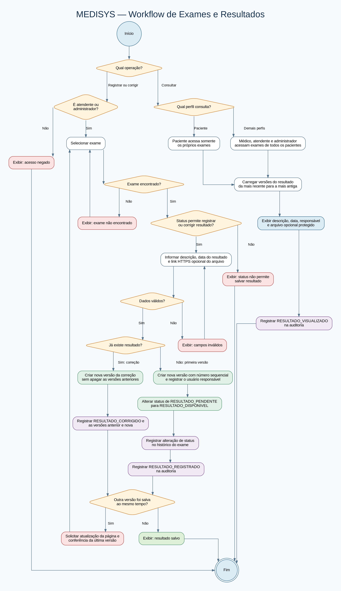

# Workflow de exames e resultados

O diagrama apresenta o fluxo implementado para registrar, corrigir e consultar resultados de exames.

## Regras representadas

- Somente atendentes e administradores podem registrar ou corrigir resultados;
- O resultado possui descrição, data do resultado, usuário responsável e arquivo HTTPS opcional;
- O primeiro resultado somente pode ser registrado quando o exame está com status `RESULTADO_PENDENTE`;
- Uma correção somente pode ser feita quando já existe um resultado e o exame está com status `RESULTADO_DISPONIVEL`;
- Cada registro ou correção cria uma nova versão, sem apagar as anteriores;
- O primeiro resultado altera o status do exame para `RESULTADO_DISPONIVEL` e registra a mudança no histórico;
- Registros, correções e visualizações são armazenados na auditoria;
- O paciente consulta somente os próprios exames;
- Médicos, atendentes e administradores podem consultar exames de todos os pacientes;
- As versões são apresentadas da mais recente para a mais antiga;
- Se ocorrer uma gravação concorrente, o sistema solicita a atualização da página e a conferência da última versão.

