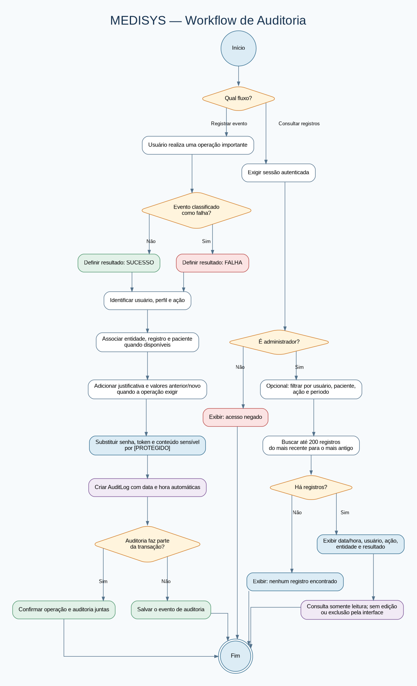

# Workflow de auditoria

O diagrama apresenta como o sistema registra e disponibiliza a consulta das operações importantes.

## Regras representadas

- Cada registro pode identificar usuário, perfil, ação, entidade, registro afetado e paciente relacionado;
- O resultado do evento é armazenado como `SUCESSO` ou `FALHA`;
- Justificativa e valores anterior e novo são incluídos quando aplicáveis;
- Senhas, tokens e conteúdos sensíveis são substituídos por `[PROTEGIDO]` antes da gravação;
- A data e a hora são geradas automaticamente pelo banco;
- Nas operações transacionais, a alteração e sua auditoria são confirmadas juntas;
- Somente administradores podem consultar a auditoria;
- A API permite filtros por usuário, paciente, ação e período;
- A consulta retorna até 200 registros, ordenados do mais recente para o mais antigo;
- A interface apresenta data e hora, usuário, ação, entidade e resultado;
- Não existe edição ou exclusão de registros de auditoria pela interface.

## Principais eventos registrados

- Login realizado, tentativa incorreta e bloqueio de conta;
- Alteração de senha;
- Cadastro, atualização e desativação de usuários;
- Agendamento e alteração de status de consultas e exames;
- Cadastro e atualização de especialidades e tipos de exame;
- Registro, correção e visualização de resultados de exames.

